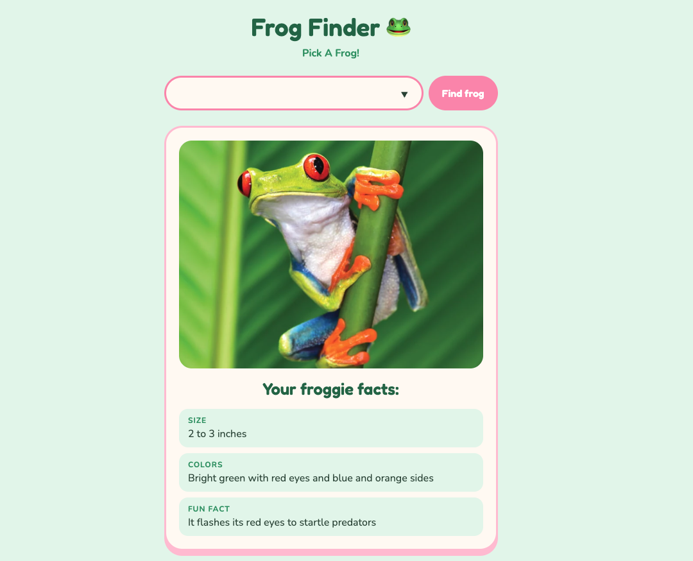

# 🐸 Frog Finder

Type in a frog's name and get its picture, size, colors, and a fun fact. Frog Finder is a small full-stack app with its own API.

**Live site:** https://frog-finder.onrender.com/



## How it works

1. You pick or type a frog name and click **Find frog**.
2. The page asks my API for that frog (`/api/frog name`).
3. The server looks the frog up and sends back its info as JSON.
4. The page shows the picture, type, size, colors, and fun fact.

If the name isn't one of my frogs, you get a mystery frog instead.

## Frogs you can search

dart frog, glass frog, whites tree frog, red eyed tree frog, bullfrog, tomato frog, goliath frog, wood frog

## Built with

- HTML and CSS
- JavaScript (`fetch`, async/await)
- Node.js and Express
- Hosted on Render

## Run it yourself

```
npm install
node server.js
```

Then open `http://localhost:3000`.

## What I learned

I learned how CRUD works. I learned how the "plumbing" of code works and how to display things client side vs server side.